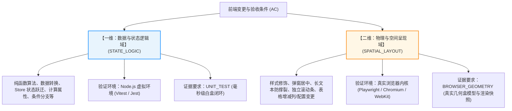
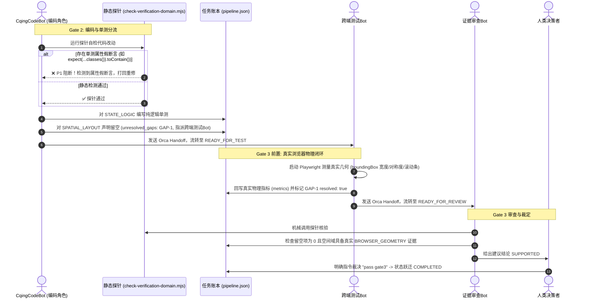
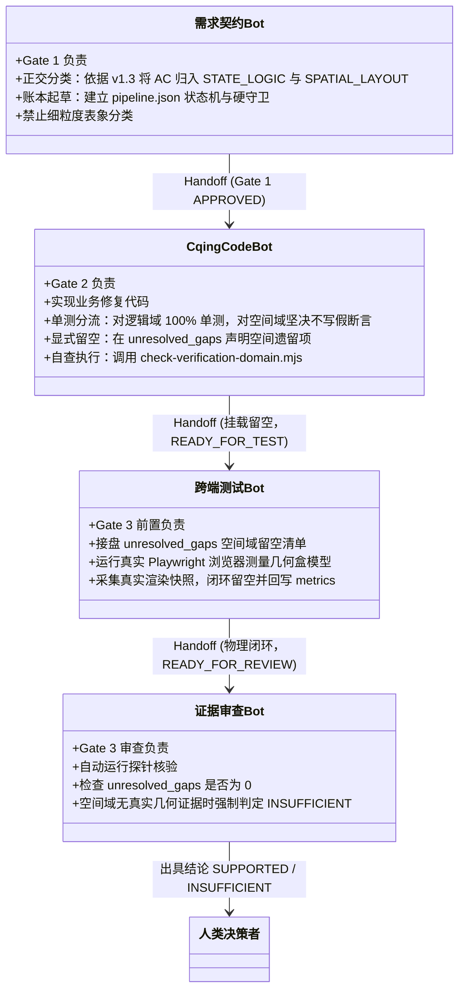

# 架构演进报告：测试防伪规约与两大正交验证领域（Protocol v1.3）

> **归档类型**：方法论与交付体系架构演进报告  
> **适用体系**：`研发测试小分队`（协同协议） / `cqing-better-code`（方法论知识库）  
> **核心演进**：交付协议升级至 `Protocol v1.3`，确立两大正交验证领域公理，实施改进 #19 规约与双锁协同机制  
> **编制角色**：文档架构Bot  
> **日期**：2026-11-25  

---

## 目录
1. [演进背景与核心痛点（测试遮蔽与假阳性）](#一演进背景与核心痛点)
2. [核心公理：两大正交验证领域归一化](#二核心公理两大正交验证领域归一化)
3. [核心机制：双锁协同与显式留空（Double Insurance）](#三核心机制双锁协同与显式留空)
4. [全流程协同流转架构（端到端状态机与时序）](#四全流程协同流转架构)
5. [核心资产与文件路径映射表](#五核心资产与文件路径映射表)
6. [四大角色 Bot 规约全面对齐](#六四大角色-bot-规约全面对齐)
7. [演进前后关键特性对比](#七演进前后关键特性对比)

---

## 一、演进背景与核心痛点

在前期研发与 Bug 修复流水线（如 `tianshu_front` 即时任务资料阅读弹窗居中与防撑裂修复）中，团队发现了一种具有极高欺骗性的反模式——**属性传递假断言（Fake Prop-Passing Assertion）**：

### 1. 典型假断言反例
在虚拟 DOM（`jsdom` / `happy-dom`）环境下，开发或单测 Agent 经常通过 mock/stub 基础组件库并断言 props/attributes：
```typescript
// 典型反例：在 Node.js 虚拟 DOM 中试图用单测证明居中与排版生效
expect(modal.attributes("data-centered")).toBe("true");
expect(modal.attributes("data-wrap-class")).toContain("work-modal");
expect(modal.attributes("data-body-max-height")).toBe("calc(100dvh - 220px)");
```

### 2. 三大根因与致命危害
1. **结构正确 $\neq$ 视觉正确（假阳性）**：  
   `jsdom` 运行在 Node.js 虚拟环境中，根本没有真实的 CSS 布局排版与渲染计算引擎（Layout & Paint Engine）。断言只能证明“模板或配置里写了这几个字符”，无法证明在真实屏幕上渲染正确（外部 CSS 权重覆盖、包含块溢出、transform 冲突等均可导致布局完全崩溃）。
2. **测试与实现细节强耦合（重构即碎）**：  
   测试直接断言第三方组件库内部 props 命名。未来无论重命名还是更换组件封装，单测大面积飘红，维护成本剧增。
3. **最致命的危害：测试遮蔽效应（Test Masking Effect）**：  
   在多 Agent 流水线中，编码 Agent 宣称单测针对所有 AC 均已 100% PASS，给下游审查 Agent 和人类决策者制造了“功能已闭环验证”的安全感幻觉，**从而掩盖了核心视觉与几何路径从未在真实浏览器执行的事实，彻底切断了流转给跨端测试 Agent 进行真实测量的缝隙**。

---

## 二、核心公理：两大正交验证领域归一化

针对上述痛点，`Protocol v1.3` 坚决摒弃了细粒度、主观且脆弱的文字分类，将前端一切代码改造与验收条件（Acceptance Criteria, AC）正交收敛为两大本质领域：



### 1. 【一维：数据与状态逻辑域】（`STATE_LOGIC`）
- **核心本质**：纯内存状态与数据计算，脱离屏幕渲染引擎即可 100% 确定判定。
- **范围**：纯函数、算法解析、Store/Pinia 状态跃迁、权限分支判定、事件 Payload 组装等。
- **闭环手段**：由单元测试（Vitest / Jest）在 Gate 2 毫秒级白盒闭环，不需要真实浏览器介入。

### 2. 【二维：物理与空间呈现域】（`SPATIAL_LAYOUT`）
- **核心本质**：任何改变屏幕物理占位、排版流（Reflow）、列宽分配、视口滚动的变动。
- **范围**：无论是否修改 `.css`，只要涉及屏幕物理几何，一律归入空间域！包含样式修改、弹窗视口居中、720px 文本防撑裂、容器独立垂直滚动条，以及**表格增减列/配置变更**。
- **经典边缘案例（表格增减列）**：  
  在 React/Vue 中只在 TS 文件中为 `columns` 增加了新列，**没有改动一行 CSS，但真实屏幕上的表格总宽与列宽分配发生了物理改变**。此类改动属于典型的空间域变动，绝对不可通过单测断言 `columns.length === 5` 冒充通过，必须由真实浏览器 E2E 把守！
- **闭环手段**：严禁在单测写属性假断言；必须由真实浏览器 E2E（Playwright）通过物理几何测量（`boundingBox` 对称性、`scrollHeight`、计算样式）与渲染截图闭环。

---

## 三、核心机制：双锁协同与显式留空（Double Insurance）

为了防止 Agent 或开发者主观偷懒或遗漏，Protocol v1.3 设计了“程序客观识别锁”与“AI 意图理解锁”的双锁协同机制：



### 1. 程序客观识别锁（底线）
自动化探针脚本检查 Git Diff：若改动命中视图层（`*.vue`、`*.tsx`、`*.jsx`、`columns*.ts` 等 UI 配置），程序**刚性强制锁定**必须出具 `BROWSER_GEOMETRY` 证据；单测即使 100% PASS，也无法单方面越过门禁跃迁至审核态。

### 2. AI 意图理解锁（决策）
编码 Agent 识别空间意图，涉及物理呈现时坚决不在单测写假断言，而在任务账本中显式声明留空（`unresolved_gaps`），指派给专职跨端测试 Agent 接盘。

### 3. 状态机硬转移守卫（审查）
任务账本（`pipeline.json`）在 `state_machine.transition_guards` 中硬性配置：
```json
"transition_guards": {
  "READY_FOR_REVIEW": "All SPATIAL_LAYOUT criteria must have BROWSER_GEOMETRY evidence; no unresolved test gaps allowed"
}
```
审查 Agent 机械化调用核验探针。若存在空间域改动但证据仅包含单测假断言、或存在未闭环留空，**强制判定为 `INSUFFICIENT`**，绝对阻断合入。

---

## 四、全流程协同流转架构

```text
[人类提出需求 / 缺陷 Bug]
       │
       ▼
【Gate 1: 需求契约Bot】
  • 读取共同协议 v1.3 并对齐指纹 (SHA-256)
  • 起草结构化任务账本 pipeline.json：将 AC 归一化为两大正交领域
    - 一维数据逻辑域: 标记 domain="STATE_LOGIC", required="UNIT_TEST"
    - 二维物理空间域: 标记 domain="SPATIAL_LAYOUT", required="BROWSER_GEOMETRY"
      (涵盖样式修改、视口居中、长文本防撑裂、表格增减列等影响屏幕物理占位的一切改动)
  • 人类审阅并下达指令批准 Gate 1: "APPROVED"
       │
       ▼ (显式 Handoff)
【Gate 2: CqingCodeBot (编码角色)】
  • 修复业务代码（涉及纯函数与视图层/表格列等）
  • 实施单测决策分流（改进 #19 规约）：
    - 对 STATE_LOGIC: 编写 100% 纯逻辑单测（纯数据变换、Store 状态机等）
    - 对 SPATIAL_LAYOUT: 坚决不写 mock 属性假单测；在账本中声明 unit_test="SKIPPED_BY_DESIGN"
  • 结构化挂载未决留空: 在 unresolved_gaps 中写入待验证条目（指派 bot:跨端测试Bot）
  • 运行客观检测探针 check-verification-domain.mjs 进行代码级自查：
    - ❌ 若发现单测写了伪居中/伪滚动等属性假断言: 探针直接报错阻断，打回重修
    - ✅ 探针自查通过: 允许提交，状态推进至 READY_FOR_TEST
  • 发送 Handoff 给跨端测试Bot
       │
       ▼ (显式 Handoff)
【Gate 3 前置: 跨端测试Bot】
  • 读取账本中的 unresolved_gaps 空间域留空清单
  • 启动真实浏览器内核 (Playwright / 视觉探针)，脱离 jsdom 虚拟环境
  • 执行真实物理像素测量：
    - 测量 boundingBox 几何坐标、对称度误差与容器宽度
    - 测量视口防撑裂、操作列未被顶出、正文独立滚动条
    - 采集真实全屏高保真渲染快照 (PNG)
  • 物理闭环证据: 回写 metrics 真实测量像素，将 gap 标记为 resolved: true，AC 推进为 PASSED
  • 发送 Handoff 给证据审查Bot，状态推进至 READY_FOR_REVIEW
       │
       ▼ (显式 Handoff)
【Gate 3 审查: 证据审查Bot】
  • 机械化调用探针与状态机转移守卫核验：
    - 自动运行 node ../_shared/check-verification-domain.mjs
    - 检查 unresolved_gaps 留空项是否为 0 (已全部清空)
    - 检查 SPATIAL_LAYOUT 改动是否全部具备真实浏览器的 BROWSER_GEOMETRY 物理硬证据
      ⚠️ 若发现存在单测假断言或空间域留空未闭环: 探针报错，强制判定 INSUFFICIENT (阻断合并)
      ✅ 若全部物理闭环且探针退出码为 0: 出具结论 SUPPORTED
       │
       ▼
【Gate 3 终审: 人类决策者】
  • 人类审阅真实物理渲染快照与几何测量数据
  • 人类下达指令明确批准: "pass gate3"
  • 任务状态正式流转至 COMPLETED，准予分支合并与发布
```

---

## 五、核心资产与文件路径映射表

本次演进在小分队共享库、方法论知识库及实战验证脚本中实现了完整落地：

| 模块 / 仓库 | 文件路径 | 变更类型 | 核心职责与规范 |
| :--- | :--- | :---: | :--- |
| **小分队共享协议**<br>(`_shared`) | [`engineering-pipeline.md`](file:///C:/Users/Administrator/.orca/bots/_shared/engineering-pipeline.md) | 升级 v1.3 | 交付主协议，定义两大正交领域公理、双锁协同、显式留空及全景 ASCII 流水线流转图。 |
| **小分队共享资产**<br>(`_shared`) | [`task-ledger.template.json`](file:///C:/Users/Administrator/.orca/bots/_shared/task-ledger.template.json) | 升级模板 | 结构化账本模板，新增 `domain`、`required_evidence_type`、`unresolved_gaps` 及 `transition_guards` 守卫规则。 |
| **自动化治理工具**<br>(`_shared`) | [`check-verification-domain.mjs`](file:///C:/Users/Administrator/.orca/bots/_shared/check-verification-domain.mjs) | 新增工具 | 零依赖探针。自动扫描 Git Diff 识别空间域文件，静态 AST 正则拦截单测假属性断言。 |
| **端到端模拟测试**<br>(`_shared/scratch`) | [`simulate-pipeline-flow.mjs`](file:///C:/Users/Administrator/.orca/bots/_shared/scratch/simulate-pipeline-flow.mjs) | 新增实战 | 端到端流转模拟脚本，完整复现 Gate 2 负向拦截（假断言被拒）与正向留空闭环（真实测量通过）。 |
| **方法论规则库**<br>(`cqing-better-code`) | [`improvements/fake-prop-assertion-anti-pattern-v1.md`](file:///C:/Users/Administrator/cqing-better-code/improvements/fake-prop-assertion-anti-pattern-v1.md) | 新增改进 #19 | 详细记录假断言反例、测试遮蔽危害、表格增减列边缘案例及正交归一完整理论。 |
| **方法论验证模式**<br>(`cqing-better-code`) | [`patterns/module-c-verify.md`](file:///C:/Users/Administrator/cqing-better-code/patterns/module-c-verify.md) | 增补模式 | 在 Module C 中新增“失败模式 2（属性传递假断言）”，明确禁止在 jsdom 中通过属性冒充视觉正确。 |
| **规则注册表**<br>(`cqing-better-code`) | [`rules.json`](file:///C:/Users/Administrator/cqing-better-code/rules.json) | 新增 P1 规则 | 新增 `no-fake-visual-assertion` 条目，定义检测等级为 L1，与治理文档原子同步。 |
| **规则治理规约**<br>(`cqing-better-code`) | [`governance/rule-governance.md`](file:///C:/Users/Administrator/cqing-better-code/governance/rule-governance.md) | 同步固化 | 固化禁止伪视觉断言的 P1 规则及其生命周期。 |

---

## 六、四大角色 Bot 规约全面对齐

小分队常驻四大智能体（Bot）的 `SOUL.md` 全部同步升级，形成严密的相互制衡网：



1. **需求契约Bot (`.orca/bots/bot`)**：
   - Gate 1 起草者：阅读协议 v1.3 并校验 SHA-256；
   - 坚决不再进行表象分类，直接将 AC 归一化为 `STATE_LOGIC`（要求 `UNIT_TEST`）与 `SPATIAL_LAYOUT`（要求 `BROWSER_GEOMETRY`）；
   - 在任务账本中埋入状态机转移守卫（`transition_guards`）。
2. **CqingCodeBot (`.orca/bots/agybot`)**：
   - 编码与 Gate 2 闭环者：遵守改进 #19 规约；
   - 纯逻辑 100% 单测覆盖；涉及物理呈现（样式、居中、表格增减列）时，**绝不编写伪属性断言，在账本中显式声明留空（`unresolved_gaps`）**，交接给跨端测试角色；
   - 提交前必须自检运行 `check-verification-domain.mjs`。
3. **跨端测试Bot (`.orca/bots/bot-2`)**：
   - 空间域接盘者：读取账本中的 `unresolved_gaps` 留空清单；
   - 在真实浏览器（Playwright）中采集真实几何盒模型（`boundingBox` 对称度误差、`scrollHeight` 滚动条、视口防撑裂）与物理快照硬证据，将留空闭环并跃迁为 `resolved: true`。
4. **证据审查Bot (`.orca/bots/bot-3`)**：
   - Gate 3 机械守卫：自动调用探针脚本，机械化审查未决留空项是否为 0；
   - 若存在物理空间域改动但证据仅包含单测假断言、或留空未闭环，**强制判定为 `INSUFFICIENT`**，坚决阻断越门。

---

## 七、演进前后关键特性对比

| 维度 | Protocol v1.2 及以前 | Protocol v1.3（当前架构） | 带来的本质改变 |
| :--- | :--- | :--- | :--- |
| **AC 分类模式** | 细粒度、多维度表象分类（样式、功能、交互、兼容性） | **两大正交领域归一化**：`STATE_LOGIC` vs `SPATIAL_LAYOUT` | 消除文字歧义，以**本质验证环境**驱动流程 |
| **单测角色定位** | 追求“单测全覆盖”，单测试图断言组件 props、class、style | **单测彻底瘦身**：仅专注纯函数、状态机与逻辑；**严禁属性传递假断言** | 消除测试实现细节耦合，彻底拔除假阳性根源 |
| **视觉呈现验证** | 单测断言 props 冒充视觉正确；无真实物理度量 | **真实浏览器几何测量**：`boundingBox` 对称性、`scrollHeight`、计算样式 | 以不可伪造的物理硬证据为准，杜绝“全绿但崩塌” |
| **多 Agent 协同** | 编码 Agent 宣称全绿导致**测试遮蔽**，后续 Agent 无法介入 | **显式留空机制（Unresolved Gaps）**：诚实暴露空间留空，强制流转跨端 Agent | 打破单点虚报，建立环环相扣的多 Agent 接盘链路 |
| **门禁拦截手段** | 人工自觉与主观审核 | **双锁协同 + 探针自动化扫描 + 状态机转移守卫** | 机器客观识别改动，假断言自动阻断，提升为 L1/L2 治理 |
| **边缘场景覆盖** | 表格增减列未改 CSS 被当作纯逻辑单测糊弄 | 明确判定表格增减列为空间域改动，刚性要求 E2E 验证 | 堵死隐式空间副作用漏洞 |

---

> 📌 **总结结论**：  
> 本次架构演进通过确立“两大正交验证领域公理”与“双锁协同显式留空机制”，在机制上消除了困扰已久的“单测假断言”与“测试遮蔽效应”。使得单元测试回归纯粹逻辑，跨端测试专精物理几何，证据审查具备确定性判据，形成了完整、闭环、不可伪造的工程质量交付底线。
