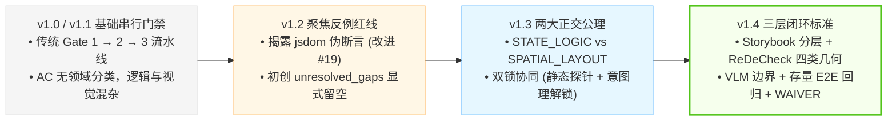
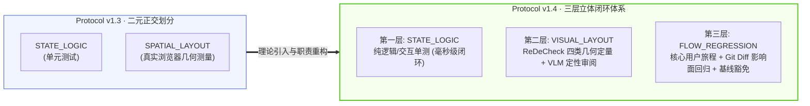
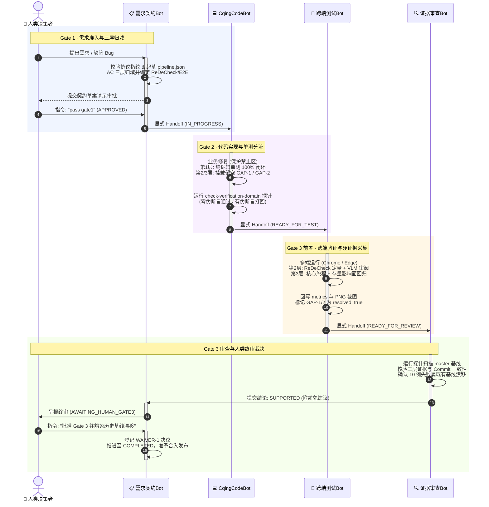
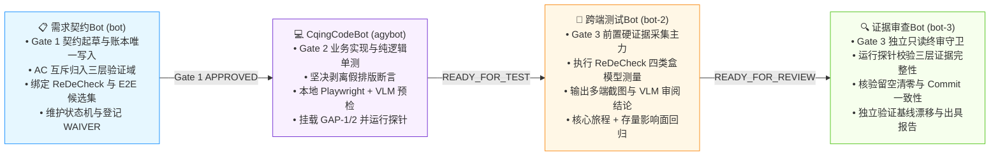

# 研发测试小分队共同交付协议演进对比全景报告（v1.0 至 v1.4）

> **归档类型**：交付协议与方法论架构全景演进报告  
> **适用体系**：研发测试小分队（协同协议） / `tianshu_front`（真实工程验证） / `cqing-better-code`（方法论体系）  
> **核心演进**：梳理共同交付协议从 **v1.0（基础串行门禁）** → **v1.2（反例红线与留空初创）** → **v1.3（两大正交验证领域公理）** → **v1.4（三层闭环标准与职责重构）** 的完整脉络；深度剖析 v1.3 到 v1.4 的根本性变革，并附以 `TASK-TIANSHU-ISSUE-2-V14` 真实工程落地案例全景还原。  
> **编制角色**：文档架构Bot  
> **基准日期**：2026-11-25

---

## 目录

1. [协议演进背景与四大阶段全景脉络](#一协议演进背景与四大阶段全景脉络)
2. [v1.3 到 v1.4 的根本性变革深度剖析](#二v13-到-v14-的根本性变革深度剖析)
3. [v1.0 至 v1.4 全维度对比矩阵表](#三v10-至-v14-全维度对比矩阵表)
4. [Protocol v1.4 全流程协同流转架构图](#四protocol-v14-全流程协同流转架构图)
5. [四大 Bot 角色主要职责重新划分](#五四大-bot-角色主要职责重新划分)
6. [实战案例还原：Issue #2 弹窗修复在 v1.4 下的落地检验](#六实战案例还原issue-2-弹窗修复在-v14-下的落地检验)
7. [核心资产与文件路径映射清单](#七核心资产与文件路径映射清单)

---

## 一、协议演进背景与四大阶段全景脉络

研发测试小分队是由 **需求契约Bot**、**CqingCodeBot**（或 `agybot`）、**跨端测试Bot** 与 **证据审查Bot** 组成的四个正交自治智能体群体。在长期的前端工程交付与缺陷修复中，交付协议历经了四个标志性阶段：



### 1.1 v1.0 / v1.1 阶段：基础串行门禁（流程初建）

- **运行机制**：定义了基于状态机的标准交接流程：`Gate 1（需求契约）` → `Gate 2（编码实现）` → `Gate 3（测试验证）` → `审查 Bot 复核` → `人类决策者裁定`。
- **核心痛点**：
  - **验收条件（AC）缺乏本质分类**：需求契约中的 AC 均采用业务描述（如“弹窗正常展示”、“数据正常加载”），未将“纯逻辑计算”与“屏幕视觉物理呈现”从验证手段上解耦。
  - **单测假阳性严重**：开发只要让单元测试全部变绿，即可宣称功能完成，导致大量包含 CSS 错位、弹窗右偏、文本溢出撑裂的代码在单测 100% 通过的“掩护”下合入主干。

### 1.2 v1.2 阶段：聚焦特定反例与留空初创（定点打补丁）

- **演进契机**：在 `tianshu_front` Issue #2 即时任务资料阅读弹窗居中与防撑裂修复中，发现开发或单测 Agent 经常在虚拟 DOM（`jsdom`）下单测组件：

  ```typescript
  // v1.2 捕捉到的典型假断言反例
  expect(modal.props('centered')).toBe(true);
  expect(modal.attributes('data-centered')).toBe('true');
  expect(modal.classes()).toContain('material-reader__copy');
  ```

- **治理手段**：沉淀方法论 **【改进 #19】**，确立负面清单红线，严禁在虚拟 DOM 单测中通过组件属性传递伪断言冒充视觉正确；初创 `unresolved_gaps`（未决留空）机制，强制开发将未验证的空间项留空转交给测试。
- **局限性**：仅针对“弹窗居中”等特定场景打补丁，属于个案防御；对于 **“只修改了 TS 表格列 `columns` 增加一列、未改动一行 CSS 但造成屏幕物理排版挤压撑裂”** 等隐式空间变动，缺乏成体系的识别与拦截能力。

### 1.3 v1.3 阶段：两大正交验证领域公理（公理化收敛）

- **核心突破**：彻底打破脆弱的文字与功能分类，正交抽象为两大本质物理领域：
  1. **一维：数据与状态逻辑域（`STATE_LOGIC`）**：纯函数、算法、Store 跃迁、状态机布尔值。脱离屏幕渲染引擎即可 100% 确定判定，由单元测试（Vitest / Jest）在 Gate 2 白盒毫秒级闭环。
  2. **二维：物理与空间呈现域（`SPATIAL_LAYOUT`）**：样式修饰、弹窗居中、长文本折行、容器独立滚动条，以及**表格增减列/配置变更**。无论是否改 CSS，只要影响屏幕物理占位，一律归入空间域，严禁单测伪断言，必须由真实浏览器 E2E 通过几何盒模型（`boundingBox` 对称性误差、`scrollHeight`、计算样式）闭环。
- **双锁协同（Double Insurance）**：
  - **程序客观识别锁（底线）**：开发静态探针 `check-verification-domain.mjs`，扫描 Git Diff 文件扩展名、表格列关键词及单测 AST/正则，强行阻断伪断言。
  - **AI 意图理解锁（决策）**：编码 Bot 识别空间意图，在单测声明 `SKIPPED_BY_DESIGN`，主动在账本挂载留空。

### 1.4 v1.4 阶段：三层闭环标准与职责重构（工业级立体闭环）

- **升级动因**：
  - v1.3 的 `SPATIAL_LAYOUT` 验证过于宽泛，缺乏统一的几何失效标准；
  - 缺乏视觉体验的定性审阅机制（单靠像素测量可能漏掉拥挤、错位违和）；
  - 缺乏**端到端全链路业务流穿越**以及**存量 E2E 影响面回归分析**，容易出现“修好了新弹窗几何，却搞崩了老业务流程或存量选择器”。
- **核心升级**：
  - 融合 **Storybook《UI Testing Handbook》** 分层测试理论；
  - 引入 **ReDeCheck (ISSTA 2017)** 响应式布局 4 类几何失效规约；
  - 确立 **VLM（多模态大模型）视觉边界**（定量归引擎，定性归 VLM，严禁用 VLM 目测替代几何断言）；
  - 全面升级为 **三层闭环架构（`STATE_LOGIC` → `VISUAL_LAYOUT` → `FLOW_REGRESSION`）**，并对四大智能体职责进行系统性重构。

---

## 二、v1.3 到 v1.4 的根本性变革深度剖析

v1.3 向 v1.4 的跨越，是研发测试小分队从“点状防伪”走向“工业级立体质量工程”的决定性飞跃：



### 2.1 理论基础升级：三大工程与学术体系支撑

- **Storybook Visual Testing Handbook 分层理念**：将组件测试严格拆解为逻辑态、视觉呈现与端到端交互流，杜绝单层代偿。
- **ReDeCheck (ISSTA 2017) 响应式布局 4 类几何失效规范**：不再笼统断言“居中”，而是形式化收敛为 4 类可量化指标：
  1. **Overflow（溢出与撑裂）**：严格断言 `scrollWidth <= clientWidth`，长文本/超长 URL 强制折行，右侧操作按钮不被挤出视口；
  2. **Overlap（重叠与遮挡）**：关闭按钮、提示角标或浮层不得压盖标题与正文；
  3. **Incongruous Wrapping / Alignment（折行异常与对齐错位）**：视口水平居中左右边距对称误差必须 `< 2px`（`Math.abs(leftMargin - rightMargin) < 2`）；
  4. **Scroll Isolation（滚动独立性）**：弹窗内部 `max-height` 约束生效，长正文触发内部独立滚动（`scrollHeight > clientHeight`），且滚动期间主页面 `window.scrollY` 保持稳定，**严禁穿透滚动（Scroll Chaining）**。
- **VLM 多模态视觉边界规范**：
  - **定量几何归浏览器引擎（`BROWSER_GEOMETRY`）**：坐标、宽度、溢出、滚动条必须由 Playwright 盒模型测量，**严禁用 VLM 看图估算像素**；
  - **定性体验归 VLM（`MULTIMODAL_VISUAL`）**：排版拥挤违和、文字截断/乱码、视觉层次等软性体验，通过高保真 PNG 截图交由 VLM 审阅闭环。

### 2.2 验证领域重塑：二元划分 → 三层立体闭环

- **第一层：`STATE_LOGIC`（逻辑与状态）**：Vitest 纯单测闭环，保持轻量与极速。
- **第二层：`VISUAL_LAYOUT`（空间布局与视觉呈现）**：双通道闭环——ReDeCheck 四类几何定量指标（JSON） + 真实浏览器高保真截图与 VLM 定性审阅（PNG）。
- **第三层：`FLOW_REGRESSION`（端到端业务回归）**：
  - 穿越核心用户旅程（打开弹窗 → 滚动 → 复制链接 → 关闭弹窗恢复面板状态）；
  - 运行探针自动扫描受影响的存量 `e2e/*.spec.ts`，进行全量防破坏回归。

### 2.3 工具探针升级：语法反例拦截 → 全生命周期守卫

- **自动三层归域**：准确识别第一层逻辑、第二层视觉、测试资产与契约文档变动；
- **语法扫描加固**：不仅拦截 `data-centered`、`props('centered')`，还拦截在 `jsdom` 中直接断言内联 `style` 字符串等伪排版行为；
- **Git Diff 影响面 E2E 回归分析器**：自动提取改动组件的类名、驼峰标识、`data-action` / `data-field` 锚点，精准逆向检索 `e2e/` 目录中所有引用该锚点的存量测试文件，输出强制回归清单。

### 2.4 首创“存量基线漂移与人类豁免机制（Waiver Protocol）”

- **工程痛点**：大型前端单体仓库中，历史 `master` 分支可能已存在部分失效旧用例或选择器漂移。若盲目要求“存量 E2E 100% 绿灯才准合入”，将导致流程永久阻塞。
- **v1.4 破局方案**：
  - 严格区分 **“本次改动破坏”** 与 **“既有 `master` 基线漂移”**；
  - 跨端测试 Bot 与证据审查 Bot 独立回溯 `master` 历史代码取证；
  - 在任务账本中显式设立 **`WAIVER` 机制**，经审查复核后呈报人类终审。只有人类下达明确指令（如 `批准 Gate 3 并豁免历史基线漂移`），方能跃迁至 `PASSED_WITH_WAIVER` 终态。

---

## 三、v1.0 至 v1.4 全维度对比矩阵表

| 对比维度 | Protocol v1.0 / v1.1 | Protocol v1.2 | Protocol v1.3 | Protocol v1.4（现行最新架构） |
| :--- | :--- | :--- | :--- | :--- |
| **核心架构思想** | 基础串行门禁流转 | 聚焦单测伪属性反例防御 | 两大正交物理领域公理化收敛 | **三层闭环立体质量工程体系** |
| **理论支撑** | 无特定理论 | 改进 #19 经验反例 | 物理空间与内存逻辑二元正交 | **Storybook 分层 + ReDeCheck (ISSTA 2017) + VLM 边界** |
| **AC 分类范式** | 无分类，自然语言混杂描述 | 细粒度业务属性描述 | 二维归一：`STATE_LOGIC` vs `SPATIAL_LAYOUT` | **三层互斥：`STATE_LOGIC` → `VISUAL_LAYOUT` → `FLOW_REGRESSION`** |
| **编码单测边界** | 追求单测全绿，单测覆盖视觉 | 禁用特定弹窗属性断言 | 空间域改动强制 `SKIPPED_BY_DESIGN` | **单测纯粹化（仅测逻辑/交互），剥离排版断言；鼓励本地预检** |
| **视觉验证手段** | 虚拟 DOM 单测 mock 断言 | 人工目测或简单截图 | 真实浏览器几何盒模型（`boundingBox`） | **双通道：ReDeCheck 四类定量（JSON） + 多端截图 VLM 定性（PNG）** |
| **回归保障机制** | 无回归保障，只管局部单测 | 无系统性回归 | 仅凭局部 E2E 用例验证 | **双重回归：核心用户旅程 + Diff 逆向提取存量 E2E 影响面清单** |
| **基线异常处理** | 报错卡死或开发私自跳过 | 缺乏标准，流程搁置 | 必须全通，否则判 `INSUFFICIENT` | **规范化 `WAIVER`：独立溯源 `master` 漂移，人类下达豁免裁决** |
| **自动化检测工具** | 无自动化探针 | 无自动化探针 | 静态探针 v1.3（Diff 扫描、伪断言拦截） | **静态探针 v1.4（三层归域、AST 阻断、E2E 影响面推荐）** |
| **留空流转机制** | 无留空机制，虚报全过 | 初创 `unresolved_gaps` | 状态机强约束：空间域留空清零前禁越门 | **全周期跟踪：`unresolved_gaps` 结构化挂载至 AC-2/3 并回写指标** |
| **需求契约Bot** | 记录普通文本契约 | 记录反例要求 | 按二元正交领域起草 AC 并埋守卫 | **按三层闭环起草 AC，绑定 ReDeCheck 项与 E2E 影响面候选集** |
| **CqingCodeBot** | 编码 + 编写大一统单测 | 编码 + 避免特定反例 | 编码 + 纯逻辑单测 + 声明空间留空 | **专注第 1 层逻辑单测，运行探针自检，可本地预检视觉并主动留空** |
| **跨端测试Bot** | 按需运行端到端脚本 | 接盘部分视觉留空 | 接盘空间域测量 | **核心主力：多端 ReDeCheck 定量 + VLM 审阅 + 存量影响面回归** |
| **证据审查Bot** | 核对单测通过文本 | 人工检查有无违规 | 机械复核探针退出码与留空清零 | **独立复核探针与三层证据链，独立排查基线漂移并出具 `SUPPORTED`** |
| **人类决策者** | 口头沟通，凭感觉批准 | 仅看单测结果判断 | 审查物理几何数据后批准 | **审阅 ReDeCheck 指标、VLM 截图、E2E 报告及豁免申请后行使终审权** |

---

## 四、Protocol v1.4 全流程协同流转架构图

### 4.1 横版跨角色协同流程图（Role & Stage Flowchart）

> 按交付阶段从左至右推进，每一泳道清晰界定对应 **角色**、**核心操作** 与 **状态交接条件**：

```mermaid
flowchart LR
    Start(["👤 人类<br/>提出需求 / Bug"])

    subgraph G1["Gate 1 · 📋 需求契约Bot"]
        direction TB
        G1_A["校验协议 SHA-256 指纹<br/>起草账本 pipeline.json"]
        G1_B["AC 互斥归入三层验证域<br/>绑定 ReDeCheck 与 E2E 候选"]
        G1_C{"👤 人类审批 Gate 1<br/>指令: pass gate1"}
        G1_A --> G1_B --> G1_C
    end

    subgraph G2["Gate 2 · 💻 CqingCodeBot"]
        direction TB
        G2_A["实现业务代码 (护禁止区)<br/>第1层: 纯逻辑单测 100%"]
        G2_B["第2/3层: 声明 SKIPPED_BY_DESIGN<br/>挂载留空 GAP-1 & GAP-2"]
        G2_C{"运行静态探针自检<br/>check-verification-domain"}
        G2_A --> G2_B --> G2_C
        G2_C -->|"❌ 假断言打回"| G2_A
    end

    subgraph G3T["Gate 3 前置 · 🧪 跨端测试Bot"]
        direction TB
        G3T_A["驱动 Chrome / Edge 多端实测<br/>第2层: ReDeCheck 几何 + VLM"]
        G3T_B["第3层: 核心旅程穿越 (4/4)<br/>+ 存量影响面回归 (88/10)"]
        G3T_C["回写指标 JSON 与截图 PNG<br/>留空清零 resolved: true"]
        G3T_A --> G3T_B --> G3T_C
    end

    subgraph G3A["Gate 3 审查 · 🔍 证据审查Bot"]
        direction TB
        G3A_A["只读复核代码与账本<br/>运行探针扫描 master"]
        G3A_B["核验三层证据与 Commit 一致<br/>独立溯源 10 例基线漂移"]
        G3A_C["出具建议: SUPPORTED<br/>呈报终审并附豁免建议"]
        G3A_A --> G3A_B --> G3A_C
    end

    subgraph G3H["Gate 3 终审 · 👤 人类 & 契约Bot"]
        direction TB
        H_Final{"👤 人类终审裁决<br/>批准 Gate 3 并豁免漂移"}
        C_Waive["📋 需求契约Bot<br/>登记 WAIVER-1 决议"]
        Done(["✅ COMPLETED<br/>准予合入与发布"])
        H_Final --> C_Waive --> Done
    end

    Start --> G1_A
    G1_C -->|"Handoff<br/>IN_PROGRESS"| G2_A
    G2_C -->|"Handoff<br/>READY_FOR_TEST"| G3T_A
    G3T_C -->|"Handoff<br/>READY_FOR_REVIEW"| G3A_A
    G3A_C -->|"AWAITING_HUMAN"| H_Final

    style G1 fill:#f0f5ff,stroke:#2f54eb,stroke-width:1px
    style G2 fill:#f9f0ff,stroke:#722ed1,stroke-width:1px
    style G3T fill:#fff7e6,stroke:#fa8c16,stroke-width:1px
    style G3A fill:#e6fffb,stroke:#13c2c2,stroke-width:1px
    style G3H fill:#f6ffed,stroke:#52c41a,stroke-width:2px
    style Done fill:#d9f7be,stroke:#52c41a,stroke-width:2px
```



### 4.2 跨角色交互时序图（Cross-Role Sequence Diagram）

> 呈现五大角色间的消息传递、生命周期激活（Activation）、探针校验与交接指令顺序：



### 4.3 各阶段执行标准与交接明细表

| 阶段门禁 | 负责角色 | 核心输入 | 关键执行动作 | 准出条件 / 交付物 |
| :--- | :--- | :--- | :--- | :--- |
| **Gate 1**<br/>需求准入 | `需求契约Bot` | 人类需求 / Bug 描述 | 1. 校验协议 v1.4 SHA-256 指纹<br/>2. 起草 `pipeline.json`，将 AC 归入三层域<br/>3. 绑定 ReDeCheck 4 项检查与 E2E 候选集 | 人类下达 `pass gate1`（`APPROVED`），状态置为 `IN_PROGRESS` |
| **Gate 2**<br/>编码实现 | `CqingCodeBot` | 已批准契约 + `pipeline.json` | 1. 严格在允许目录内修改业务代码<br/>2. 编写第 1 层纯逻辑单测（0 排版伪断言）<br/>3. 声明 `SKIPPED_BY_DESIGN`，挂载 `GAP-1/2`<br/>4. 运行 `check-verification-domain.mjs` 自检 | 探针退出码 `exit 0`，生成受影响 E2E 建议清单，状态置为 `READY_FOR_TEST` |
| **Gate 3 前置**<br/>跨端实测 | `跨端测试Bot` | `GAP-1/2` 留空 + E2E 候选集 | 1. 驱动真实 Chrome / Edge 多端内核<br/>2. 采集 ReDeCheck 定量 JSON 与高保真 PNG<br/>3. 完成 VLM 视觉审阅与核心旅程端到端用例<br/>4. 全量回归受影响存量 E2E 并排查失败归因 | `GAP-1/2` 全部标为 `resolved: true`，三层硬证据回写账本，状态置为 `READY_FOR_REVIEW` |
| **Gate 3 审查**<br/>独立复核 | `证据审查Bot` | 完整 Commit + 三层原始证据 | 1. 保持代码只读，运行探针扫描 `master`<br/>2. 核对证据链完整与 Commit ID 一致性<br/>3. 独立核查存量失败是否属既有基线漂移 | 出具审查结论 `SUPPORTED`（附豁免建议），状态置为 `AWAITING_HUMAN_GATE3` |
| **Gate 3 终审**<br/>人类裁决 | `人类决策者` | 几何 JSON + 截图 + 审查报告 | 审阅 ReDeCheck 指标、多端 PNG 截图及基线漂移说明，行使终审权 | 人类下达明确指令批准并豁免，登记 `WAIVER-1`，状态跃迁至 `COMPLETED` |

---

## 五、四大 Bot 角色主要职责重新划分

Protocol v1.4 对小分队各智能体的权责边界进行了精细化重构，彻底消除权责重叠与盲区：



### 5.1 需求契约Bot (`bot`)
- **升级核心**：从“写需求文字”转变为“定义三层闭环架构”。
- **主要权责**：起草契约时严格指定各 AC 属于 `STATE_LOGIC`、`VISUAL_LAYOUT` 还是 `FLOW_REGRESSION`；明确绑定 ReDeCheck 4 类检查要求及初筛的受影响 E2E 范围；作为任务账本的**唯一法定写入者**，全流程校验四角色协议指纹、记录交接与裁决。

### 5.2 CqingCodeBot (`agybot`)
- **升级核心**：从“试图在单测里搞定所有验证”转变为“单测纯粹化 + 显式暴露留空”。
- **主要权责**：高质量实现业务代码；单测专注于纯逻辑算法、数据转换与交互分支（毫秒级闭环）；绝不编写组件属性假断言；主动在账本挂载 `unresolved_gaps`；允许并在提交前运行探针与本地视觉预检。

### 5.3 跨端测试Bot (`bot-2`)
- **升级核心**：**本次 v1.4 权责拓展最大的角色**。由过去“只跑个别 E2E 脚本”升级为 **“第二层空间视觉定量定性 + 第三层端到端与存量回归”的唯一主力**。
- **主要权责**：接盘所有留空项；启动多端真实浏览器执行 ReDeCheck 几何盒模型测量（输出 JSON）；采集跨端高保真截图并出具 VLM 视觉审阅结论；完整运行核心用户旅程与受影响存量 E2E 测试集；排查存量失败归因并提供原始证据。

### 5.4 证据审查Bot (`bot-3`)
- **升级核心**：从“形式主义看日志”升级为“三层立体证据与基线漂移独立复核”。
- **主要权责**：保持环境与代码只读；自动化运行探针核验；核查三层证据是否真实存在且属于对应 Commit；若存在存量 E2E 失败，独立在 `master` 分支排查验证是否属于既有基线漂移，出具严谨的 `SUPPORTED` 审查报告。

---

## 六、实战案例还原：Issue #2 弹窗修复在 v1.4 下的落地检验

在对比工作区（分支 `fix/issue-2-modal-layout-v14`，任务 `TASK-TIANSHU-ISSUE-2-V14`）中，小分队严格按照 Protocol v1.4 规范完成了全流程闭环实战：

### 6.1 业务缺陷背景
- **任务**：GitLab Issue #2 即时任务资料与差异阅读弹窗未居中及文本溢出撑裂问题；
- **目标文件**：`TaskMaterialPanel.vue`（阅读弹窗）、`PartnerMaterialReader.vue`、`PartnerDifferenceReader.vue`。

### 6.2 Gate 1：三层验收条件精准确立
需求契约Bot 起草 `requirements.md`（版本 `v1.4.0`），将 AC 收敛为三层：
- **AC-1 (`STATE_LOGIC`)**：弹窗开闭状态机、空数据安全拦截、复制链接剪贴板回调与异常输入处理（要求 `UNIT_TEST`）；
- **AC-2 (`VISUAL_LAYOUT`)**：弹窗宽度 `≤ 720px`、长文本自动折行防撑裂、无碰撞遮挡、视口水平居中对称误差 `< 2px`、长内容独立垂直滚动且不穿透主页面（要求 `BROWSER_GEOMETRY + MULTIMODAL_VISUAL`）；
- **AC-3 (`FLOW_REGRESSION`)**：核心用户旅程穿越 + 5 个受影响存量 E2E 用例回归（要求 `E2E_REGRESSION`）。
- **人类裁定**：人类下达 `pass gate1` 批准启动。

### 6.3 Gate 2：编码修复与单测决策分流
- **代码修复**：CqingCodeBot 在 Commit `5bd71fa` 中精准修复样式与布局（补充 `min-width: 0`、`gap` 间距、居中类与滚动约束），未触碰禁止区与 `880px` 选择器弹窗；
- **单测白盒闭环**：编写 `TaskMaterialPanel.test.ts`，453 行代码覆盖 45 项纯逻辑用例（`45/45 PASSED`），**0 假属性断言**；
- **留空挂载**：在账本中将 AC-2 与 AC-3 单测标为 `SKIPPED_BY_DESIGN`，挂载 `GAP-1` 与 `GAP-2` 交接给跨端测试Bot；
- **探针自查**：运行探针 `exit 0`，成功识别出 5 个受影响的存量 E2E 文件。

### 6.4 Gate 3 前置：跨端测试硬证据闭环与基线漂移排查
跨端测试Bot 在 Commit `515ce38` 中交付了详实的硬证据：
1. **ReDeCheck 定量几何实测（Chrome & Edge 双端）**：
   - `overflow_passed: true`（弹窗最大宽度精确为 `720px`，`scrollWidth <= clientWidth`）；
   - `overlap_passed: true`（关闭按钮与正文无重叠遮挡）；
   - `wrapping_alignment_error_px: 0`（完美居中，左右边距对称误差为 `0px`，远低于 `2px` 阈值）；
   - `scroll_isolation_passed: true`（内部独立滚动生效，页面 `window.scrollY` 为 `0` 无穿透）；
   - 测试视口断点：覆盖 `desktop-1440`、`tablet-768`、`mobile-390`。
2. **VLM 多模态定性视觉审阅**：
   - 采集 12 张高保真全屏与局部 PNG 截图；
   - VLM 定性审阅全过，确认文字排版无挤压、无截断乱码、视觉层次分明。
3. **端到端业务与影响面回归**：
   - 核心用户旅程：`e2e/taskReaderModalV14.spec.ts` `4/4 PASSED`；
   - 5 个存量用例全量回归（共 98 条次）：**`88 passed, 10 failed (exit code 1)`**；
   - **深查确证**：对 10 个失败点逆向排查，独立核实 `task-material-suggestion-hint` 等 3 个旧选择器在 `master` 分支本身不存在，属于存量基线环境漂移，非本次修复引入。

### 6.5 Gate 3 审查与终审裁决（`WAIVER-1` 落地）
- **证据审查Bot 复核**：复核 Commit `515ce38`，探针 `exit 0`，三层证据齐全无伪造，`GAP-1` 与 `GAP-2` 已闭环；确认 10 例存量失败确属 `master` 既有漂移，出具建议结论 `SUPPORTED`。
- **人类终审**：人类决策者审阅 12 张截图、几何 JSON 与基线分析报告，在 Orca Item #6 下达明确终审裁决：
  > **人类指令原文**：批准 Gate 3 并豁免历史基线漂移
- **终态跃迁**：账本正式登记 **`WAIVER-1`**，AC-3 状态跃迁至 `PASSED_WITH_WAIVER`，任务整体推进至 **`COMPLETED`**，圆满实现高质量闭环。

---

## 七、核心资产与文件路径映射清单

| 资产类型 / 规范归属 | 跨平台相对路径 / 工程位置 | 核心版本 / 职责作用 |
| :--- | :--- | :---: |
| **小分队主交付协议** | [engineering-pipeline.md](./engineering-pipeline.md) | **v1.4** 现行共同交付协议全貌与时序规范 |
| **三层自动化核验探针** | [check-verification-domain.mjs](./check-verification-domain.mjs) | **v1.4** 零依赖探针，支持三层归域、假断言扫描与 E2E 影响面分析 |
| **结构化账本模板** | [task-ledger.template.json](./task-ledger.template.json) | **v1.4** 任务状态机账本标准模板 |
| **既有 v1.3 总结报告** | [测试防伪规约与两大正交验证领域（Protocol v1.3）架构演进总结报告.md](./测试防伪规约与两大正交验证领域（Protocol%20v1.3）架构演进总结报告.md) | **v1.3** 阶段性归档总结报告（归档留存） |
| **本次交付全景报告** | [研发测试小分队交付协议演进对比报告（v1.0至v1.4）.md](./研发测试小分队交付协议演进对比报告（v1.0至v1.4）.md) | **全量演进对比报告**（本文件） |
| **对比工作区需求契约** | `tianshu_front/docs/plan/tianshu-issue-2-v14/requirements.md` | **v1.4** 真实需求契约与三层验收条件（`fix/issue-2-modal-layout-v14`） |
| **对比工作区执行账本** | `tianshu_front/docs/plan/tianshu-issue-2-v14/pipeline.json` | **v1.4** 全生命周期账本、ReDeCheck 指标、VLM 审阅及 `WAIVER-1` 记录 |

---

> 📌 **演进结论**：  
> 从 v1.0 的“混沌串行”，到 v1.2 的“反例防御”，再到 v1.3 的“正交归一”，最终演进至 v1.4 的“三层立体闭环”，研发测试小分队交付协议完成了从经验性约束到现代软件工程科学体系的蜕变。通过将 Storybook 分层理念、ReDeCheck 几何规范、VLM 视觉边界与影响面 E2E 回归有机融合，彻底根除了单测假阳性与测试遮蔽，实现了前端复杂场景下不可伪造、高确定性、人机协同的交付质量底线！
